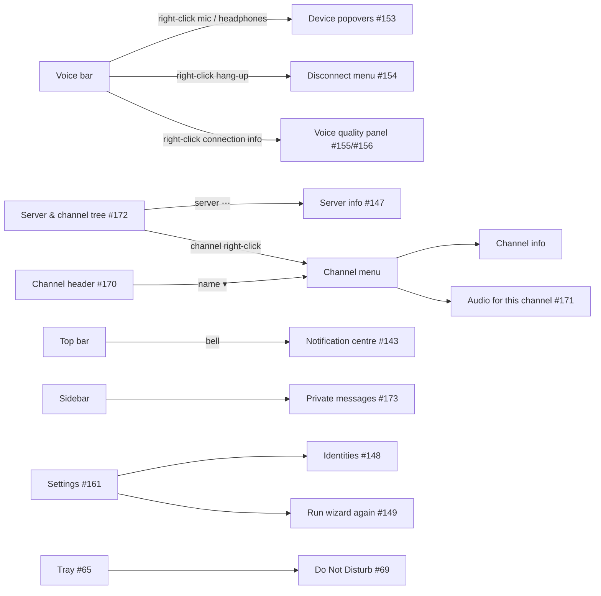
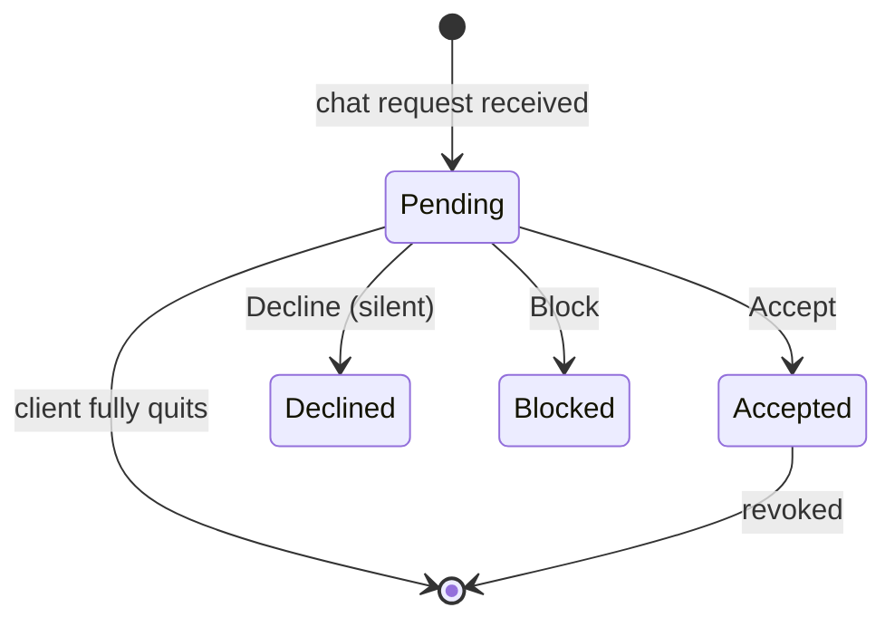

# Mumcord · Epic 3 – Comfort & polish · Specification

> Status: Final (documented from issues) · As of: 2026-10-30
> Sources: overview issue #63, all issues in milestone 0.5.0 (#62, #64–#70, #108, #131, #140, #141, #143, #146–#149, #151, #153–#156, #159–#161, #163–#165, #168–#173, #175, #176, #180, #181, #183, #190, #195), their mockups (wiki `images/mockups/epic3/…` and `images/mockups/156/…`) and decision comments; merged PRs #177, #182, #184, #189, #194; open PRs #185, #186, #187, #192, #193, #197, #198, #199; `CHANGELOG.md`; `specs/03-comfort-polish-brainstorming.md` (answered points)
> Builds on: `specs/01-foundation-specification.md` and `specs/02-multi-server-themes-specification.md` (all decisions there stay valid unless this spec names a change). Detailed sub-specs on the branch of PR #197: `specs/03-identity-manager-specification.md` (#148) and `specs/03-server-dialog-specification.md` (#151); they stay the source of truth for those two features.
> Numbering: the sub-specs use FR-3.1 … FR-3.44 and AC-3.1 … AC-3.29. This spec starts at FR-3.50 and AC-3.50 so the numbers never collide.

## 1. Goal & context

Epic 1 made Mumcord a daily client, Epic 2 kept several servers connected at once and added themes and the first peer-to-peer features. Epic 3 is about comfort: everything people do often gets shorter (right-click menus on the voice bar, quick device and quality switching, a calmer channel tree and private messages overview), people get control over who may reach them (block, private message rules, Do Not Disturb, a notification centre), power users get several identities, per-channel audio and a low-latency mode for playing music together, and Mumcord gets an in-app updater and a redesigned setup wizard and Settings window. The epic was planned directly in GitHub issues (overview #63, milestone 0.5.0) instead of brainstorming rounds; this spec documents those issues and the work already done. Everything stays a pure client against unmodified Mumble servers.

## 2. Scope

### 2.1 In scope (milestone 0.5.0)

- **Voice & audio:** quick device popovers on mute/deafen (#153), voice quality quick panel (#155), low-latency mode (#156), per-channel audio profiles (#171), high-quality noise suppression as Beta (#176), every PipeWire device listed (#183), whisper and shout (#67), global hotkeys beyond push-to-talk (#64).
- **Voice bar:** disconnect menu with "Leave voice" (#154).
- **Servers, identity & navigation:** identity manager (#148), redesigned add/edit server dialog (#151), labelled channel passwords (#146), server info panel (#147, plus #190 once #62 exists), redesigned server and channel tree (#172), channel header menu and channel info (#170), collapsible member column (#165), public server browser (#68), import from the official Mumble client (#66), `mumble://` link cards (#175).
- **Chat, privacy & notifications:** block users (#140), private message rules with chat and message requests (#141), notification centre (#143), redesigned private messages overview (#173), Do Not Disturb (#69), `@all` / `@channel` mentions (#70).
- **Setup & settings:** redesigned setup wizard with presets (#159), run the wizard again (#149), Settings window redesign (#161).
- **Watch together & screen share:** privacy setting respected (#160), redesigned views (#163), pop-out window (#164).
- **Desktop integration:** full tray menu (#65).
- **Peer-to-peer relay (client side):** "Use relay" setting and fallback order for the optional mumpeer relay (#62).
- **Updates & distribution:** in-app updater (#168, moved here from Epic 5), Windows signing (#180), portable Windows build (#181).
- **Developer & quality:** packet inspector follow and capture-on-open (#169), Rust style rules (#108), tracked dependency advisories (#131), Epic 3 verification walkthrough and E2E specs (#195).

### 2.2 Out of scope / later

- **Anything on the server side.** No server plugins, protocol extensions or server config changes. The mumpeer relay server (repo Mumcord/mumpeer) and the mumbot registration module (repo Mumcord/mumbot) are separate products; this epic builds only the client side (FR-3.140). The webhook bot specs moved to Mumcord/mumbot.
- **Report and ban** (admin features) → Epic 4 (#140).
- **Flathub listing** (#178) → Epic 5.
- **Leaving Beta** for high-quality noise suppression (#176) and low-latency mode (#156): a later decision.
- **New watch party providers** beyond YouTube and Twitch, recording, annotations on a shared screen (#163).
- **5 ms / 2.5 ms Opus frames** in low-latency mode: 10 ms is the floor (#156).
- **Slim avatar rail** for the collapsed member column (#165, variant B rejected).
- **Sharing a channel audio profile** with other users via plugin data (#171, "for the future").
- **Per-server device choice** and a device-cycling hotkey (#153, optional; not built in PR #193).

## 3. Roles & permissions

Everything in this epic is local to the client. The server enforces only what it always enforces (ACLs for move, enter, speak, text, whisper). The client hides actions the user's permissions don't allow.

| Action | Any user | User with move permission | Note |
|---|---|---|---|
| Block a user, set PM rules, DND, notification centre | ✅ | ✅ | Local only; the other side is never told (#140, #141) |
| Whisper / shout to users or channels | ✅ (if the server's ACL grants whisper) | ✅ | Server enforces the ACL (#67) |
| `@all` / `@channel` mention | ✅ (everyone may use it; each user can opt out per server, Q1.6) | ✅ | Plain chat text; official clients see the text (#70) |
| "Move users here…" and drag a user onto a channel | ❌ hidden | ✅ | Server enforces (#172) |
| Per-channel audio profile, low-latency mode | ✅ | ✅ | Affects only the own client (#156, #171) |
| Install an update | ✅ | ✅ | Local; deb/rpm/AUR go through the package manager (#168) |

## 4. Functional requirements

### 4.1 Voice & audio

**Quick device switching (#153, PR #193)**
- **FR-3.50** Left-click on the mute and deafen buttons keeps today's behaviour. Right-click, the menu key / Shift+F10 or a small arrow next to the button opens a popover.
- **FR-3.51** Microphone popover: input devices (current checked, system default marked), input volume 0–200 %, live level meter, noise suppression switch, "Voice settings…" link. Headphones popover: output devices, output volume 0–100 %, "Test sound", "Voice settings…" link.
- **FR-3.52** Switching applies at once without reconnecting; hot-plugged devices appear live; a vanished device falls back to the system default with a one-time notice.

**Voice quality quick panel (#155, PR #185)**
- **FR-3.53** Right-click, menu key / Shift+F10 or the ▾ on the connection info button opens "Voice quality"; left-click still opens the statistics.
- **FR-3.54** Contents: bitrate slider (the same setting as Settings → Audio, FR-2.64, showing the server limit and the bitrate actually sent), Music quality switch, low-latency switch (#156), estimated bandwidth incl. packet headers against the server limit, the audio health rating (#152), "Voice settings…". Changes apply and persist at once.
- **FR-3.55** Bitrate and music quality stay global settings (per-channel overrides come only through FR-3.62).

**Low-latency mode (#156, PR #198, Beta)**
- **FR-3.56** One switch (Settings → Audio and the quick panel, Beta badge). When on: 10 ms Opus frames, one per packet, restricted low-delay application (CELT); jitter buffer target at most one packet + 10 ms; echo cancellation, noise suppression and automatic volume bypassed; devices opened at 48 kHz with small buffers (128 frames, falling back to the host default when refused). Switching happens live between two packets, without reconnecting.
- **FR-3.57** Low-latency mode includes the music-quality signal path; the Music quality switch shows as dimmed and "included" while it is on (mockup comment on #156).
- **FR-3.58** A latency estimate is shown with its breakdown (microphone buffer, frame + look-ahead, half the ping, jitter target, processing, speaker buffer, total) and the other mode for comparison; the bandwidth meter counts the doubled header overhead and warns above the server limit.
- **FR-3.59** Turning it on shows the trade-offs: more bandwidth, glitches on Wi-Fi, headphones needed (echo cancellation off), push-to-talk or open mic recommended.
- **FR-3.60** Official Mumble clients play the packets normally; no server change.
- **FR-3.61** Sending voice over a direct peer-to-peer path as well is not part of PR #198 or 0.5.0; it needs work on both sides and ideally the relay (#62) (Q1.9).

**Per-channel audio profiles (#171)**
- **FR-3.62** A profile per server + channel holds Music quality (on/off/default), Low-latency mode (on/off/default) and a bitrate cap (value or default). It is stored locally, keyed by channel id and channel path so a renamed or recreated channel still matches.
- **FR-3.63** It applies when the user joins that channel and the previous values return when they leave. Precedence: channel profile > global setting; the server's bandwidth limit and the per-packet limit (QA.82) always win. (The issue mentions a "server profile"; none exists, see Q1.10.)
- **FR-3.64** Set from the channel-name menu ("Audio for this channel…", #170), the channel's right-click menu in the tree (#172) and channel info. A ♪ or ⚡ badge marks channels with a profile (with a text label for screen readers). The active source is shown in the connection info and quick panel ("Music quality (channel profile)"). "Remove profile" returns to the defaults.

**Noise suppression levels and Advanced (AI) (#176, PR #126, Beta)**
- **FR-3.65** The setup wizard and Settings → Voice offer noise suppression as four levels, weakest first: **Light** (sonora-ns, one fixed strength, for steady noise, lowest CPU), **Standard** (nnnoiseless, default), **Advanced (AI)** with a Beta badge (Mumcord/rnnoise-rs, RNNoise 2024 model, about three times the CPU of Standard) and **Off**. A "?" InfoTip next to each level says what it is good for and its CPU cost. No level has options of its own (sonora-ns's strength setting from PR #126 was dropped), and there is no consent gate for rnnoise-rs, since it comes from Mumcord's own fork. Settings rows that stored a library name load as the matching level.
- **FR-3.66** The fork is a git dependency pinned to a tag, used only in crates Mumcord does not publish (or behind a feature the published crates don't enable). It builds on the backend selection of PR #126.
- **FR-3.67** Weights ship in the app only if the size is acceptable; otherwise they are downloaded on first use after the user turns the option on, with a verified checksum.
- **FR-3.68** If processing overloads (audio health rating, #152), Mumcord falls back to the light backend with a notice. Low-latency mode turns it off unless the user forces it.

**Audio devices on Linux (#183, PR #194, done)**
- **FR-3.69** With PipeWire, every sink and source is listed with its friendly name, stored by its stable node name and played to exactly that node; without PipeWire the ALSA list stays as before. An old saved device migrates to the single matching node, otherwise to the system default with a one-time notice.

**Whisper and shout (#67)**
- **FR-3.70** Whisper to specific users, a channel, or a channel with sub-channels or linked channels, through the standard Mumble VoiceTarget messages, so it works with any server and official clients.
- **FR-3.71** Whisper targets are set up in Settings (mockup `67-whisper-setup`) and used by holding their key; while whispering, the voice bar clearly says to whom. Incoming whispers and shouts are marked on the speaker. Targets can also be created from the person and channel menus ("Whisper to…"), each with an optional hotkey (Q1.7).

**Global hotkeys (#64)**
- **FR-3.72** Configurable global shortcuts that work in the background: mute/unmute, deafen, switch to a channel or back, toggle Do Not Disturb, and the whisper targets (FR-3.71). Conflicts are detected and shown.
- **FR-3.73** Works on Windows, macOS, X11 and Wayland (global-shortcuts portal; X11 compatibility mode as fallback, as for push-to-talk in spec 01). No global hotkeys are set by default (users pick them) and they are global for all servers; whisper targets are created in Settings and from the person and channel menus ("Whisper to…"), each with an optional hotkey; on GNOME without a tray there is no tray menu and closing the window follows the existing close setting (Q1.7).

### 4.2 Voice bar

**Disconnect menu (#154, PR #186)**
- **FR-3.74** Left-click on the hang-up button disconnects the voice server at once, as today.
- **FR-3.75** Right-click, the menu key / Shift+F10 or a ▾ opens a menu: **Leave voice**, **Disconnect from ‹server›**, one **Switch voice to ‹server›** item per other connected server (flat items instead of a submenu, hidden with one server), **Disconnect from all servers…** (the only item with a confirmation, focus on Cancel).
- **FR-3.76** Leave voice keeps the server connected and the user in the current channel, self-deafened and muted like any read-along server (FR-2.5, option 1 of the issue). No server has voice until the next explicit join. No AFK-channel setting.
- **FR-3.77** The hang-up sound plays for both disconnect actions, not for Leave voice. The queued chat messages are still drained on disconnect (#74, #89).

### 4.3 Servers, identity & navigation

**Identity manager (#148) and server dialog (#151), PR #197**
- **FR-3.78** Specified in full in `specs/03-identity-manager-specification.md` (FR-3.1 … FR-3.19) and `specs/03-server-dialog-specification.md` (FR-3.30 … FR-3.44). In short: several identities with one default and a per-server override, certificates only in the OS secure storage, the old identity becomes "Default"; the server dialog has four tabs (Connection, Identity, Passwords, Behaviour), inline validation and "Test connection".
- **FR-3.79** Blocks (#140) and accepted conversations (#141) are kept per own identity (identity spec decision D11).

**Labelled channel passwords (#146, PR #189, done)**
- **FR-3.80** A password entered at the channel prompt is stored with that channel (name, path, id); the list shows "Officers (Raid)" with the full path and last use, several channels per password, "(not found)" for removed or renamed channels, and a free label. Passwords stay in the OS secure storage; only labels and channel info go into the database. Older passwords keep "Password N" until they're next used.

**Server info panel (#147, PR #192)**
- **FR-3.81** Opened from the server's ⋯ menu → "Server info" (server entry and server header). Shows name and address (copy), server version and OS, sanitised welcome text, max users and online, bandwidth and message limits, allowed codecs, own session, registration and permissions, TLS certificate (issuer, SHA-256 fingerprint, validity, trusted/changed, "Show certificate", copy fingerprint), connection figures, the number of Mumcord users, and "Copy diagnostics" (no chat content, no audio).
- **FR-3.82** Nothing is sent anywhere; every value comes from what the server sends to every client.
- **FR-3.83** "Mumbot: yes/no" and "Mumpeer relay: yes/no" are added once #62 defines the announcement (#190); a missing announcement means "no".

**Server and channel tree (#172)**
- **FR-3.84** Right-click (menu key / Shift+F10) on a channel: Join channel (Shift+Enter), Enter password… (protected channels only), Follow / Unfollow, Notification settings (all / mentions only / nothing), Channel info, Copy channel link, Audio for this channel… (#171), Move users here… (move permission only), Clear history (danger colour, confirmation). Items the user may not use are hidden.
- **FR-3.85** A channel with a user limit shows `Name (n/max)`; a full channel is dimmed with the count in the warning colour and the tooltip / announcement "Channel full, 5 of 5 places taken". No count without a limit.
- **FR-3.86** Tree: indentation guides, collapsible sub-channels (remembered per server), icons for password, temporary, linked, followed, unread and mentions; voice users with talking ring and mute/deafen icons; the own channel marked with an accent bar; each connected server a collapsible section with a connection dot, ping and ⋯ menu; drag a user onto a channel (move permission only); a filter for channels and people (Ctrl+K).

**Channel header and channel info (#170)**
- **FR-3.87** Following is an icon in front of the channel name (filled when followed, outlined when not); clicking it toggles follow, with tooltip and aria-label. No separate Follow or Clear history buttons.
- **FR-3.88** Clicking the channel name (with ▾) opens a menu: Follow / Unfollow, Clear chat history… (confirmation, respects the #119 watermark), Channel info, Audio for this channel… (#171), Copy channel link, Notification settings, Channel password… (only if relevant).
- **FR-3.89** Channel info: name and path, sanitised description, users / max users, temporary or permanent, password indicator and whether a saved password unlocks it (#146), linked channels, own permissions, follow state and last history clear, Copy link.

**Collapsible member column (#165, PR #177, done)**
- **FR-3.90** The member column can be hidden completely so the chat uses the full width (variant C2). A members button in the chat header shows and hides it; while the column is hidden the button shows the member count and a talking dot when someone speaks. In a narrow window the column opens as an overlay over the chat. The shortcut is the fixed Ctrl+Shift+M until configurable shortcuts exist (#64). The state is remembered globally, not per server.

**Public server browser (#68)**
- **FR-3.91** Browse and search the public Mumble server list (the list the official client uses) by name, country, ping and user count; connect or add to favourites in one click.
- **FR-3.92** The list loads only when the user opens the browser. Pings are paced, never sent to all servers at once. The source is the public list the official Mumble client uses, requested with an honest `User-Agent: Mumcord/<version>` and `Accept-Encoding: gzip` (the list answers 501 without it). Checked 2026-10-30: it publishes no terms of use (Q1.8, implemented in #68).

**Import from the official Mumble client (#66)**
- **FR-3.93** Detect an installed official client and import server favourites (host, port, user name, stored password into the OS secure storage), the client certificate (as a new identity via #148) and suitable settings (audio devices, push-to-talk key, volume).
- **FR-3.94** Offered in the setup wizard (Welcome "import settings" link and the identity step, #159) and in Settings, with a summary before anything is written. Duplicates are skipped, not overwritten.

**`mumble://` link cards (#175, PR #199)**
- **FR-3.95** A `mumble://[user@]host[:port]/[channel/path]` link in a message gets a card: server name or host, host and port (64738 by default, IPv6), channel path, live ping, users / max and version; buttons Join (or Go to channel when connected), Add to servers, Copy link. A saved server shows its label and the identity it would use.
- **FR-3.96** Live figures come from the standard public UDP ping, sent only while link previews are allowed and never for links from blocked users. Nothing connects without a click. Credentials in a link trigger a warning; passwords are stripped and never shown or copied. Everything returned is untrusted. Unreachable → "Server not reachable" + Retry; invalid → no card; at most 3 cards per message; the composer shows a preview card without buttons.

### 4.4 Chat, privacy & notifications

**Block users (#140)**
- **FR-3.97** "Block" / "Unblock" in the person menu and profile, with a confirmation that says they can still see the user and their messages. Settings → Privacy → Blocked users lists name, server and since when, with Unblock. A blocked user is marked in the member list (for the user only).
- **FR-3.98** Blocking hides their private messages (no notification, no auto-reply), collapses or hides their channel messages (setting), mutes their voice locally including whisper and shout, ignores all Mumcord plugin data from them (hello extras, now playing, invites, cards, history sync, P2P and relay offers) and all mention and reply notifications from them.
- **FR-3.99** Keyed by certificate hash, plus an optional "block this name" for unregistered users. Kept per own identity (FR-3.79). A block is global for that identity: one block covers every server; the Blocked users list still shows where it was set (Q1.4).

**Private message rules and requests (#141)**
- **FR-3.100** Setting "Private messages from: Everyone / Friends only / Nobody", with a per-server override. Exceptions (with Friends only): "People in my current channel" and "Conversations I've accepted" (I wrote first, replied, or accepted a request; revocable). Channel chat is unaffected. Also applies to privately sent Mumcord extras (invites, cards).
- **FR-3.101** Filtering is local and silent: no auto-reply. Filtered messages from non-Mumcord senders go to a "Message requests" list (or are dropped, by setting).
- **FR-3.102** Mumcord-to-Mumcord **chat requests**: a hidden plugin-data message `mumcord-chatreq` (documented in Plugin-Data-Protocol) with an optional short, sanitised note, sent only to that one user when both run Mumcord. The recipient gets Accept / Decline / Block; Accept adds the sender to accepted conversations and tells them; Decline is silent (sender sees "pending"). One open request per person, a cooldown after a decline, plus the plugin-data rate limit.
- **FR-3.103** Open chat requests and message requests (received and sent) live in memory only and are deleted when the client fully quits (not when minimised to the tray). Accepted conversations and blocks are saved.
- **FR-3.104** Requests show in the notification centre (#143) and the private messages overview (#173), and are collected, not notified, during Do Not Disturb.

**Notification centre (#143)**
- **FR-3.105** A bell with an unread badge in the top bar opens a panel across all connected servers: mentions (incl. `@all` / `@channel`), replies, chat and message requests (Accept / Decline / Block in place), invites (watch party, screen share, join game, theme and message cards sent privately), and the update entry (#168).
- **FR-3.106** Newest first, grouped by type or server, filters Mentions / Requests / Invites, per-item dismiss, "Mark all as read"; each item names its server and clicking switches to that server and message.
- **FR-3.107** OS toasts still appear unless Do Not Disturb is on; then everything is collected here. Blocks and PM rules apply. Requests are memory-only (FR-3.103); mentions and replies stay until read or for a limited time (7 days proposed). Keyboard shortcut, arrow-key navigation, screen-reader labels. Connection events also go in, e.g. "server X unreachable" after the banner has hidden itself (#88) (Q1.18).

**Private messages overview (#173)**
- **FR-3.108** One merged list of all conversations across servers, sorted by the latest message, pinned first. Each row: avatar with online state, name, server tag, sanitised preview, time, unread count (grey when muted), pin and mute indicators.
- **FR-3.109** Search, filter All / Unread / Requests with live counts, "Start a new conversation" (pick a user on any connected server). Message requests (#141) at the top with Accept / Decline / Block; more than one collapse to "Show n more requests". Friends skip the request section.
- **FR-3.110** Right-click (menu key / Shift+F10): Mark as read, Pin / Unpin, Mute (1 h, 8 h, until turned back on), View profile, Block… (#140), Delete history (this device only, confirmation). Read state is shared with the notification centre. Empty state "No conversations yet" with the start button.

**Do Not Disturb (#69)**
- **FR-3.111** A Mumcord switch (quick settings, tray, optional hotkey) silences notification sounds and toasts, including mentions, replies and activity sounds, across all servers. Badges still count; the notification centre collects.
- **FR-3.112** "Follow system Do Not Disturb" (default on): effective DND = Mumcord switch **or** the OS state (Windows Focus Assist / Do not disturb, macOS Focus, KDE Plasma and GNOME DND; other desktops best effort). Changes are picked up live. The UI says which source is active ("Do Not Disturb (system)"); the Mumcord switch can't turn off the system DND. If the OS state can't be read, the setting says so.
- **FR-3.113** Do Not Disturb has no exceptions (friends, `@all` / `@channel`), is not shown to other users and has no automatic modes (while gaming or screen sharing); following the system Do Not Disturb covers most of it (Q1.5).

**`@all` and `@channel` mentions (#70)**
- **FR-3.114** `@all` notifies everyone on the server who can read the channel, `@channel` everyone in the channel, like a personal mention. Plain chat text, so official clients just see the text. Autocomplete suggests both. Everyone may use them; each user can turn off notifications for `@all` / `@channel` per server (Q1.6).

### 4.5 Setup & settings

**Setup wizard (#159)**
- **FR-3.115** Flow: Welcome (value proposition, language picker, "import settings" link) → Identity (create or import, #148, #66) → Voice (devices, live mic test, noise suppression, voice activation with threshold or push-to-talk) → Setup style → [Custom only: Private messages → Connections and content → Features → Appearance → Startup and updates] → You're all set (summary cards, each with Edit).
- **FR-3.116** Setup style offers four cards: Everything on, **Balanced (Recommended)**, Maximum privacy, Custom. Presets 1–3 jump straight to the summary (button "Finish setup"); Custom walks the detailed steps ("Next"). Preset values as in the #159 Presets table (e.g. Balanced: PMs from friends with both exceptions, requests on, direct + relay with direct first, previews on, external images click to load, embeds off, full-size images and history sync on, now playing and now gaming off, overlay on, follow system DND on). Unlisted settings keep their recommended defaults.
- **FR-3.117** A left step rail with progress; Back / Next everywhere, Skip on optional steps; every toggle explains in one sentence what it does and who sees it; wizard and Settings share the same setting keys and components.

**Run the wizard again (#149)**
- **FR-3.118** Settings → About → "Run setup wizard again" opens the wizard without the identity step, with all values prefilled and the note "Your identity is not changed" (link to the identity manager). Cancel on every step keeps everything; nothing is saved before Finish; Finish writes only changed values. Identity commands are never called. The rerun step list follows the #159 flow (Q1.3).

**Settings window (#161)**
- **FR-3.119** Ten groups: General, Account & Identity, Voice & Audio, Chat & Notifications, Privacy & Connections, Appearance, Servers, Gaming & Overlay, and set apart at the bottom Advanced & Developer and About, each a page of section cards (mapping table in #161).
- **FR-3.120** One row layout (label, one-line description, control on the right); "Recommended" hints; live previews (theme, mic level with threshold); "Reset section" with a confirmation; badges Beta, Changed and "Overridden on N servers"; the active preset in the sidebar footer with "Switch".
- **FR-3.121** Search over labels, descriptions, synonyms and option names, grouped results with counts, highlighted matches, keyboard navigation, Ctrl+F / Cmd+F.
- **FR-3.122** Diagnostics viewer in Advanced & Developer: view the report in sections with search, Copy as text, Copy as Markdown, Save; a note on what's included; visited link-preview hosts never appear in it. #161 is a design issue; its build ships in 0.5.0 after the features that add new settings, under its own short build spec (Q1.2).

### 4.6 Watch together & screen share

**Privacy setting respected (#160, PR #184, done)**
- **FR-3.123** With "Show link previews and embeds" off, "Watch together" stays listed but disabled with the reason and a link to the Privacy settings; a running party shows "A watch party is running: enable embedded players to join"; nothing is requested from YouTube or Twitch (no player page, no thumbnails).

**Redesigned views (#163)**
- **FR-3.124** Watch together opens a cinema view in the main column (16:9 player, channel chat below); leaving keeps a mini player docked at the top of the chat. Overlay controls: title, who added it, who controls, sync pill, Request control; previous / play-pause / next, seek bar with buffered range and viewer markers, volume, time, last action, picture-in-picture, pop out, fullscreen.
- **FR-3.125** Playlist panel: now playing, up next with thumbnails, full titles, duration, who added it, drag and keyboard reorder (Alt+↑/↓), ⋯ menu, paste field. "Who's watching" with per-person sync state (In sync / Buffering / N s behind) from the positions the party protocol already exchanges. The host has a crown; when the host leaves, the lowest session takes over (existing rule).
- **FR-3.126** Screen share viewer in the main column: sharer, LIVE, what is shared, chips for resolution, fps, bitrate, path (direct or relay) and sound; "Stream details"; volume, Fit / Fill / 1:1, Focus, pop out, fullscreen, Stop watching; a panel "Watching (n / 8)" with per-viewer quality and path.
- **FR-3.127** Sharer control bar: live thumbnail, LIVE, elapsed time, source and quality; Pause, Sound, Change window, Viewers (quality per viewer, hint when lowered), Stop.
- **FR-3.128** Shared keys: Space, ←/→ 5 s, M, F, I, Z, 1, Esc. Reduced motion keeps overlays visible. The cinema view never loads YouTube or Twitch before the user joins (#160). Everyone may control playback; "Request control" is dropped. Picture-in-picture is the pop-out window (#164) with always on top (Q1.11).

**Pop-out window (#164)**
- **FR-3.129** "Pop out" moves the player or screen share viewer into its own resizable OS window; the main window shows a slim placeholder (title, progress, sync, play/pause, Pop back in, close). The window only renders; audio, sync, playlist and connection stay in the main app; closing the main window closes it.
- **FR-3.130** It keeps aspect ratio, remembers size, position and monitor (primary monitor as fallback), has an "Always on top" pin (remembered per kind), and closing it (or Ctrl+W) docks the view again without stopping anything. Title names content and channel. One pop-out per kind.
- **FR-3.131** Built through `aux_window` with a restricted capability (player commands and events only). The docked player unloads while popped out. Screen share frames must reach the window at least as fast as the docked view (transport chosen during build). The #160 rule applies unchanged.

### 4.7 Desktop integration

**Full tray menu (#65)**
- **FR-3.132** Tray / menu bar menu: connection state per server, mute and deafen, Do Not Disturb, switch voice server or channel (submenus), recent private chats, Open, Settings, Quit. The tray icon reflects talking, muted and unread / mentions (mockup `epic3-65-tray-menu-and-icon-states`). On GNOME without a tray there is no tray menu and closing the window follows the existing close setting (Q1.7).

### 4.8 Peer-to-peer relay, client side (#62)

- **FR-3.140** Setting "Use relay": Off / Only when a direct connection fails (default) / Always (hides my IP address). Fallback order: direct → relay (if announced) → feature unavailable with a clear reason, as today (FR-2.46).
- **FR-3.141** The relay only forwards bytes: the QUIC session stays end-to-end encrypted and certificate-pinned between the two clients. The client authenticates to the relay with its Mumble certificate.
- **FR-3.142** The relay address and per-session tokens arrive as hidden plugin data from the mumbot module; without an announcement Mumcord behaves exactly as today. Connection info and the screen share viewer show "direct" or "via relay" and whether the IP is hidden; the packet inspector shows announcements.
- **FR-3.143** The announcement format, trust model and limits need the #62 spec first, written before anything is built. Optional companion services in their own repos are allowed; Mumcord must work fully without them. CLAUDE.md and spec 02 FR-2.35 ("no STUN, TURN or other external server") were amended for this (Q1.1, section 14).

### 4.9 Updates & distribution

**In-app updater (#168)**
- **FR-3.144** Check on start, then every N hours (default 12), plus "Check now". "Update available" shows the changelog for every version between the installed and the new one; Download and install / Skip this version / Remind me later.
- **FR-3.145** Progress with size and time left, steps (download, verify, install) and Cancel, while Mumcord stays usable. "Restart to update" as button, toast and notification-centre entry; after the restart the app reconnects and rejoins. Never restarts on its own during a call.
- **FR-3.146** Setting: Download automatically (still asks before restarting) / Notify only / Off, plus interval, last check, Check now and "Stop skipping". With Off nothing is contacted. Replaces the update hint of FR-2.56.
- **FR-3.147** Platforms: Windows (silent per-user NSIS install), macOS (signed `.app.tar.gz` swap), AppImage (self-replace only when writable, else manual), deb / rpm / AUR (no self-update: changelog plus the package-manager command). The app detects its install type and never writes into system paths.
- **FR-3.148** Security: signature check with the updater's minisign key (public key in the app, private key only as a CI secret), HTTPS from `github.com/Mumcord/mumcord/releases` only, cross-check with `SHA256SUMS` and the release manifest (#144), no downgrade unless chosen, keep the previous binary until the new one started once (rollback), dev builds never auto-update, no identifiers sent.

**Windows signing (#180)**
- **FR-3.149** Sign everything shipped on Windows (`mumcord.exe`, the NSIS installer, the portable exe, uninstaller and helpers where possible), timestamped (RFC 3161), verified in CI with `signtool verify`; the release fails on an unsigned file once signing is configured. Route: Azure Artifact Signing (preferred, already wired) or an open source certificate.

**Portable Windows build (#181, PR #182, done)**
- **FR-3.150** Every release ships `Mumcord_<version>_x64-portable.zip`. A `portable` marker file next to the exe keeps data, settings, logs and caches in `MumcordData` beside it; no `mumble://` handler and no autostart unless turned on; About, diagnostics and the update hint say "Portable"; the identity stays in Windows Credential Manager; a missing WebView2 runtime shows a message with the download link.

### 4.10 Developer & quality

- **FR-3.151** Packet inspector (#169, PR #187): the list follows new packets; scrolling up or expanding a row pauses following and shows "N new packets, jump to latest"; a Follow toggle sits next to Pause and Clear. Capture starts when the inspector window opens and stops, dropping the buffer, when it closes; "Keep capturing in the background" (off, not persisted) overrides that. The list holds at most 2,000 rows instead of being virtualised.
- **FR-3.152** Rust style (#108): rustfmt options, selected lints (`missing_docs`, `undocumented_unsafe_blocks`, chosen pedantic lints) and `#[non_exhaustive]` / `#[must_use]` on the published crates, one PR per area; `#[non_exhaustive]` lands with 0.5.0 and is noted in the CHANGELOG as semver-breaking.
- **FR-3.153** Advisories (#131): every ignored advisory in `deny.toml` stays listed with its reason and is removed when the dependency is gone.
- **FR-3.154** Verification (#195): a manual walkthrough of every Epic 3 acceptance criterion in the running client against a local test server, plus WDIO E2E specs for the new flows; a failing criterion is first reproduced with a test.

## 5. UI & UX

### 5.1 Entry points

### 5.2 Mockups

All mockups are illustrative with fictional data; the rules in section 4 win. Paths are under the wiki's `images/mockups/`.

| Feature | Mockups |
|---|---|
| Hotkeys #64 | `epic3/epic3-64-hotkeys-settings-{dark,light}` |
| Tray #65 | `epic3/epic3-65-tray-menu-and-icon-states-dark` |
| Import #66 | `epic3/66-import-wizard-{dark,light}`, `66-import-summary-dark` |
| Whisper #67 | `epic3/67-whisper-setup-{dark,light}`, `67-whisper-live-{dark,light}` |
| Server browser #68 | `epic3/68-server-browser-{dark,light}` |
| DND #69 | `epic3/epic3-69-dnd-quick-settings-{dark,light}` |
| Mentions #70 | `epic3/70-mentions-{dark,light}` |
| Relay #62 | `epic3/epic3-62-relay-setting-and-connection-info-{dark,light}` |
| Block #140 | `epic3/block-menu-{dark,light}`, `block-dialog-dark`, `block-settings-dark` |
| PM rules #141 | `epic3/pm-setting-{dark,light}`, `pm-chat-request-dark` |
| Notification centre #143 | `epic3/notification-centre-{dark,light}` |
| Server info #147 | `epic3/server-info-{dark,light}` |
| Identities #148 | `epic3/epic3-ids-{dark,light}`, `epic3-srv-{dark,light}` |
| Wizard rerun #149 | `epic3/epic3-rerun-settings-{dark,light}`, `epic3-rerun-wizard-{dark,light}` |
| Server dialog #151 | `epic3/server-dialog-{dark,light}` |
| Device popovers #153 | `epic3/io-devices-{dark,light}` |
| Disconnect menu #154 | `epic3/disconnect-menu-{dark,light}` |
| Voice quality #155 | `epic3/connection-quick-panel-{dark,light}` |
| Low latency #156 | `epic3/low-latency-{dark,light}`, `156/low-latency-quick-panel-{on,off}-{dark,light}` |
| Setup wizard #159 | `epic3/wizard/wizard-0-presets` … `wizard-7-summary`, `wizard-identity` |
| Settings #161 | `epic3/settings/settings-a-voice-audio` … `settings-e-advanced-developer` |
| Watch / share views #163 | `epic3/media/watch-together-*`, `screen-share-viewer-*`, `screen-share-sharer-*` |
| Pop-out #164 | `epic3/media/pop-out-{dark,light}` |
| Member column #165 | `epic3/layout/layout-{a,b,c}-*` (variant C chosen) |
| Updater #168 | `epic3/updater/update-available-*`, `update-progress-ready-dark`, `settings-updates-dark`, `update-toast-notification-dark` |
| Channel header #170 | `epic3/channel/channel-menu-dark`, `channel-info-{dark,light}` |
| Channel audio #171 | `epic3/channel/channel-audio-{dark,light}` |
| Tree #172 | `epic3/sidebar/tree-{dark,light}` |
| PM overview #173 | `epic3/sidebar/pm-{dark,light}`, `pm-menu-dark` |
| Link card #175 | `epic3/chat/mumble-link-card-{dark,light}` |

Built features also have screenshots in `docs/images/screenshots/` (e.g. `connection-quick-panel-*`, `disconnect-menu-*`, `server-info-*`, `audio-popover-*`, `mumble-link-card-*`). Deviations documented in PRs: the disconnect menu uses flat "Switch voice to ‹server›" items and no divider (PR #186).

### 5.3 Shared UI rules

- Every new menu opens by right-click, the menu key / Shift+F10 and, where a button has one, a small ▾; arrow keys, Home/End, Esc closes and returns focus. Left-click keeps its old meaning.
- Destructive items are marked by text and icon, not colour only; only "Disconnect from all servers…", Delete history, Clear history, Block and identity delete ask for confirmation.
- All new texts in all 24 locales; only theme tokens (built-in and custom themes, light and dark); reduced motion respected; text scaling up to 200 %.
- Server-provided text (names, descriptions, welcome text, link-card replies) is sanitised before rendering.

## 6. Audio & network

- **Low-latency mode (FR-3.56):** 10 ms frames are the smallest size Mumble's 10 ms sequence numbering supports; restricted low-delay Opus has no in-band FEC, so loss is concealed only. Both encoders exist from the start because creating one allocates, which the real-time thread must not do. Target ≈ 35–45 ms mouth to ear on a good wired link with ≈ 20 ms ping vs ≈ 90 ms normally. UDP header overhead roughly doubles (≈ 29 instead of ≈ 15 kbit/s).
- **Per-channel profiles (FR-3.62):** applied on the own channel join; never sent to the server.
- **Advanced (AI) noise suppression (FR-3.65):** runs in the capture path under the real-time protection of #150; must not cause real-time demotions on a typical x86 desktop; int8 model where fast, else float.
- **Whisper and shout (FR-3.70):** standard `VoiceTarget` messages and voice packet target ids; nothing new on the wire.
- **Link cards (FR-3.96):** the standard public UDP ping (protobuf form for 1.5+ servers, legacy form for older ones); no TLS connection.
- **Server info (FR-3.81):** `Version`, `ServerConfig`, `ServerSync`, `PermissionQuery` and the server's TLS leaf certificate.
- **Relay (FR-3.140):** QUIC relaying via mumpeer, only after the #62 spec.
- Minimum server version and connection flow are unchanged from spec 01 and spec 02.

## 7. Data & state model

New or changed local data (secrets only ever in the OS secure storage):

| Data | Stored where | Lifetime / rules |
|---|---|---|
| Identities, per-server identity | Secure storage (certificates) + SQLite (label, hash, default) | See identity sub-spec |
| Channel password labels (#146) | SQLite: label, channel id, path, last used; token in secure storage | Per server |
| Blocked users (#140) | SQLite: certificate hash or name, server, since | Per own identity |
| PM rule + per-server override (#141) | Settings | Persistent |
| Accepted conversations (#141) | SQLite: certificate hash | Per own identity, revocable |
| Chat / message requests, cooldowns (#141) | Memory only | Deleted on full quit |
| Notification items (#143) | Mentions/replies: SQLite; requests: memory | Until read / limited time; requests as above |
| Pinned / muted conversations (#173) | SQLite | Persistent |
| DND switch, follow system DND (#69) | Settings | Persistent |
| Channel audio profiles (#171) | SQLite: server, channel id, channel path, 3 values | Persistent, "Remove profile" deletes |
| Low-latency, noise suppression backend, input gain, output volume | Settings | Global |
| Hotkeys, whisper targets (#64, #67) | Settings | Global (open Q1.7) |
| Member column collapsed (#165) | Settings | Persistent |
| Pop-out size, position, monitor, always on top (#164) | Settings | Per kind |
| Updater mode, interval, skipped version, last check (#168) | Settings | Persistent |
| Active setup preset (#159, #161) | Settings | "Customised" once a setting differs |
| Relay mode (#62) | Settings | Persistent |
| Inspector "keep capturing" (#169) | Memory only | Not persisted |

## 8. Technology & architecture

No new stack; spec 01 and spec 02 decisions stay. New pieces, each with a reason:

- **Tauri updater plugin + minisign key** (#168): official, handles download, signature check, install and relaunch on Windows, macOS and AppImage. The AppImage uses the same plugin path; stable channel only in 0.5.0, the portable zip only gets "Notify only", and the private key is a CI secret with rotation in `docs/release-signing.md` (Q1.12).
- **Mumcord/rnnoise-rs** (#176): pure Rust, BSD-3-Clause fork with SIMD, int8 and real-time safety work; pinned to a commit (rev), only in the unpublished engine crate, never in published crates.
- **x509-parser** (#147, PR #192): reads the server certificate details in the protocol layer.
- **PipeWire enumeration and node targeting** on Linux (#183, PR #194), ALSA as fallback.
- **Global-shortcuts portal** on Wayland (#64), reusing the push-to-talk approach of spec 01.
- **aux_window** with restricted capabilities for the pop-out (#164), as for the packet inspector and licences windows.
- **OS DND readers** per platform (#69): Windows notification state, macOS Focus status, D-Bus on KDE and GNOME.
- Protocol, audio pipeline and UI stay separate; the UI never talks to the network.

## 9. Non-functional requirements

- **Real-time audio:** no allocation, locks, I/O or logging in the audio path; encoder switches and noise suppression backends must stay inside the real-time budget (#150).
- **Latency:** low-latency mode ≈ 35–45 ms mouth to ear under the conditions of #156; the estimate is shown, not guaranteed.
- **Privacy:** nothing is sent for blocks, PM rules, DND or requests beyond the chat request itself; link-card pings and the public server list load only after explicit opt-in or opening; the updater sends no identifiers; diagnostics contain no chat content, names or visited hosts.
- **Security:** update signature + checksum + manifest check; TLS certificate details visible; passwords never shown in link cards.
- **Accessibility:** keyboard operable, screen-reader labels, system theme and scaling, reduced motion (WCAG 2.2 AA from spec 01).
- **Platforms:** as spec 02 (Windows, macOS, Linux X11 and Wayland, x86_64 and ARM64); Wayland limits for always-on-top and window placement are documented (#164).

## 10. Build, packaging & release

- **Release 0.5.0** at the end of the milestone.
- **Portable Windows zip** (#181, done): built next to the NSIS installer, included in `SHA256SUMS`, the SBOM and the release manifest, smoke-tested in CI.
- **Windows signing** (#180): Azure Artifact Signing variables in the GitHub environment `release`, federated credential for `repo:Mumcord/mumcord:environment:release`; `signtool verify` in CI; a test release on a clean Windows VM.
- **Updater bundles** (#168): a new minisign key pair; the private key only as a CI secret, the public key in the app; signed update bundles for Windows, macOS and AppImage; an integration test against a local update server (`MUMCORD_UPDATE_URL`).
- **rnnoise-rs** (#176): pinned to a commit (rev); model weights in the app or a checksummed download.
- **Rust style** (#108): one reformat commit and per-area lint PRs.

## 11. Acceptance criteria (verifiable in the running client)

All against a local test server (two servers and a second client where noted); never a public server. Identity manager: AC-3.1 … AC-3.14; server dialog: AC-3.20 … AC-3.29 (sub-specs).

Voice & audio:
- **AC-3.50** Connected → right-click the microphone button → popover lists input devices with the current one checked; pick another → the second client keeps hearing the user without a reconnect. Unplug the chosen device → system default with a notice.
- **AC-3.51** Right-click the headphones button → output list, volume, "Test sound" plays.
- **AC-3.52** Right-click the connection info → Voice quality panel; set 32 kbit/s → Settings → Audio shows 32 kbit/s and the connection info shows about 32 kbit/s within 2 s. Toggle Music quality → reflected in Settings and survives a restart. Keyboard only: Shift+F10, change every control, Esc returns focus.
- **AC-3.53** Turn on low-latency mode → warnings shown; outgoing packets are 10 ms with one frame each; an official Mumble client in the same channel plays the audio correctly; the estimate shows every part and a clearly lower total than normal mode.
- **AC-3.54** Low-latency mode with 5 % simulated loss → stays usable, concealment counters rise, no crash or stall.
- **AC-3.55** Set "Music quality + high bitrate" for channel Music → join Music → both active and shown as "(channel profile)" with a ♪ badge; leave → previous values return; remove the profile → defaults.
- **AC-3.56** Select "Advanced (AI)" noise suppression → voice still reaches the second client; under the live load test no real-time demotion; forced overload → fallback to Standard with a notice.
- **AC-3.57** Linux with PipeWire and a multi-endpoint interface → every endpoint is listed with its friendly name; choice survives replug and restart.
- **AC-3.58** Set a whisper target to the second client and hold its key → only that client hears the user, the voice bar shows the target, the receiver sees the whisper mark; an official client as receiver also hears it.
- **AC-3.59** Assign a global hotkey to mute; with Mumcord in the background press it → muted; assigning the same key twice shows a conflict.

Voice bar:
- **AC-3.60** Left-click hang-up → the voice server disconnects as before.
- **AC-3.61** Right-click hang-up → Leave voice → server stays connected, the second client sees the user deafened in the same channel, chat works; joining a channel restores voice.
- **AC-3.62** Two servers → menu shows "Switch voice to B" → voice moves, A becomes read-along. "Disconnect from all servers…" asks; Cancel changes nothing; confirm disconnects both.

Servers & navigation:
- **AC-3.63** Join a password channel and enter the password → the server dialog lists it as "‹channel› (‹parent›)" with path and last use; rename it; remove the channel on the server → "(not found)".
- **AC-3.64** Server ⋯ → Server info → version, limits, certificate fingerprint matching the server's certificate, connection figures; Copy diagnostics contains no chat content.
- **AC-3.65** Right-click a channel → the FR-3.84 items; without move permission "Move users here…" is absent; a channel with max users 5 and 5 users shows `(5/5)` dimmed with "Channel full".
- **AC-3.66** Click the follow icon in the channel header → follow toggles; channel-name menu → Channel info shows the sanitised description, limits and own permissions.
- **AC-3.67** Collapse the member column → it disappears and the chat uses the full width; "Show members" restores it; state survives a restart.
- **AC-3.68** Open the server browser → only then the list loads; filter by name; "Add to favourites" adds the server.
- **AC-3.69** With an official Mumble client profile present → wizard and Settings offer the import; favourites and certificate appear (certificate as a new identity); running it twice creates no duplicates.
- **AC-3.70** Send a `mumble://` link to the local server with a channel path → card with ping, users and version; Join connects only after the click and lands in that channel; a link with a password shows the warning and no password; with link previews off → no ping is sent.

Chat, privacy & notifications:
- **AC-3.71** Block the second client → their PMs don't show or notify, channel messages collapse, their voice is silent locally; after a name change on the same certificate they stay blocked; Unblock in Settings → Privacy restores everything.
- **AC-3.72** Set "Friends only" → a PM from a non-friend official client lands in Message requests, not in the chat; a non-friend in the same channel can write (exception on); a per-server override "Everyone" on server B lets PMs through there.
- **AC-3.73** From a second Mumcord client send a chat request → Accept / Decline / Block in the notification centre; Accept lets messages through and the sender sees "accepted"; quit and restart the recipient → open requests are gone, accepted conversations remain.
- **AC-3.74** Mention the user, reply to them and send a watch-party invite → three items in the notification centre with server names; clicking one switches to the message; Mark all as read clears the badge.
- **AC-3.75** PM overview with conversations on two servers → one list with server tags, newest first; pin, mute, Mark as read and Delete history (this device only) work; empty state offers "Start a new conversation".
- **AC-3.76** Turn on DND → a mention from the second client plays no sound and shows no toast, but the badge and notification centre count it. Turn on the OS DND with "Follow system" on → Mumcord shows "Do Not Disturb (system)".
- **AC-3.77** Second client writes `@channel` → every Mumcord user in the channel gets a mention notification; an official client shows plain text; autocomplete offers `@all` and `@channel`.

Setup & settings:
- **AC-3.78** Fresh profile → wizard shows Welcome, Identity, Voice, Setup style; Balanced → "Finish setup" → summary; every value equals the Balanced column in Settings; Custom walks steps 5–9.
- **AC-3.79** Settings → About → Run setup wizard again → no identity step, values prefilled; Cancel on any step leaves settings and identity unchanged; Finish with only the microphone changed saves only the microphone.
- **AC-3.80** Settings search "relay" → results grouped by group with the synonym match; picking one jumps to the highlighted row. Diagnostics viewer → Copy as Markdown produces a fenced block without chat content or visited hosts.

Watch together & screen share:
- **AC-3.81** Embeds off → "Watch together" disabled with the reason and link; no request to YouTube or Twitch.
- **AC-3.82** Start a party → cinema view with chat below; play, pause and seek reach the second client; a buffering member shows "Buffering" within 2 s; leaving keeps the mini player.
- **AC-3.83** Screen share viewer shows resolution, fps, bitrate, path and sound; Fit / Fill / 1:1 and Focus work; the viewer list matches the sharer's; the sharer can pause and change the window.
- **AC-3.84** Pop out the party → play/pause from the second client is followed; Ctrl+W docks it again with the party still running; after a restart the pop-out opens on the same monitor with the same size and always-on-top state.

Desktop, relay, updates, developer:
- **AC-3.85** Tray menu shows each server's state, mute, deafen, DND, voice server and channel submenus and recent chats; the icon changes when muted and on a mention.
- **AC-3.86** Without a relay announcement → P2P behaves exactly as in 0.4.x and connection info says "direct". (Relay acceptance follows the #62 spec.)
- **AC-3.87** With a local update server offering a signed newer build → dialog with the changelog excerpt; Download and install shows progress; Restart to update reconnects. A bad signature or checksum → the file is deleted and the error shown. A deb install shows the package-manager command instead.
- **AC-3.88** A Windows release candidate → every shipped exe passes `signtool verify`; the portable zip runs from a USB stick with data in `MumcordData`.
- **AC-3.89** Open the packet inspector → packets appear and the list follows; scroll up → following stops with the "new packets" button; close the window → capture stops.

## 12. Decision log

| Issue | Decision | Note |
|---|---|---|
| #63 | Epic 3 planned in GitHub issues, milestone 0.5.0, no brainstorming rounds | `specs/03-comfort-polish-brainstorming.md` |
| #165 | Collapsing hides the member column completely (variant C); no avatar rail | User decision 2026-10-29 |
| #154 | "Leave voice" stays in the current channel, self-deafened; no AFK option; flat "Switch voice to" items | PR #186 |
| #155 | Bitrate and music quality stay global; quick panel shows the audio health rating | PR #185 |
| #156 | 10 ms is the floor; low-latency mode includes music quality; Beta | Mockup comment 2026-10-30, PR #198 |
| #156 | Jitter target ≤ one packet + 10 ms; device buffers 128 frames with fallback | PR #198 |
| #170 | Follow is an icon before the channel name; Follow / Unfollow stays in the menu | User decision 2026-10-30 |
| #170 / #171 | Channel-name menu gets "Audio for this channel…" | Comment 2026-10-30 |
| #173 | One merged conversation list across servers, pinned first | Issue decision |
| #141 | Per-server override and "people in my current channel" exception confirmed; "accepted conversations" exception added | User |
| #141 | Mumcord-to-Mumcord chat requests via `mumcord-chatreq` plugin data | Comment 2026-10-29 |
| #141 | Pending requests are memory-only, deleted on full quit | Comment 2026-10-29 |
| #141 / #143 | Requests appear in the notification centre with Accept / Decline / Block | Comment 2026-10-29 |
| #148 | Blocks and accepted conversations are per own identity | Identity sub-spec D11 |
| #148 / #151 | Detailed in their own sub-specs; one PR #197 | Sub-specs |
| #147 | Opens from the server ⋯ menu; mumbot/mumpeer line split off to #190 (blocked by #62) | Comment 2026-10-29, PR #192 |
| #69 | Two DND sources: Mumcord switch or system DND; "Follow system" default on | Comment 2026-10-28 |
| #159 | Four presets (Everything on, Balanced recommended, Maximum privacy, Custom) replace "Allow all / Choose myself" | Comments 2026-10-29 |
| #159 | Setup style comes after the voice step; rerun skips identity | Comment 2026-10-29 |
| #160 | Watch together stays listed but disabled with reason and link when embeds are off | PR #184 |
| #161 | View and copy the diagnostics report in Settings | Comment 2026-10-29 |
| #168 | Updater moved from Epic 5 into Epic 3; Tauri updater plugin with its own minisign key recommended | Issue |
| #169 | Capture only while the window is open; "keep capturing" not persisted; list capped at 2,000 rows, not virtualised | PR #187 |
| #175 | Live figures from the public UDP ping only with link previews on; passwords stripped | PR #199 |
| #176 | nnnoiseless stays default; RNNoise 2024 via the Mumcord/rnnoise-rs fork as Beta | Issue |
| #181 | Portable build is a zip with a `portable` marker; identity stays in Credential Manager | PR #182 |
| #183 | PipeWire nodes listed and targeted by node name; ALSA fallback | PR #194 |
| #62 | Optional companion services in their own repos are allowed; CLAUDE.md and FR-2.35 amended; #62 spec first | Q1.1 |
| #161 | Built in 0.5.0 after the features that add new settings | Q1.2 |
| #149 | Rerun wizard = #159 flow without the identity step | Q1.3 |
| #140 | A block is global for that identity (certificate hash) | Q1.4 |
| #69 | No exceptions, no visibility to others, no automatic modes | Q1.5 |
| #70 | Everyone may use `@all` / `@channel`; per-server opt-out | Q1.6 |
| #64, #65, #67 | No default global hotkeys; whisper targets from Settings and menus; no tray menu on GNOME without a tray | Q1.7 |
| #68 | Public list of the official client, loaded on opening; no terms of use (checked 2026-10-30) | Q1.8 |
| #156 | No direct peer-to-peer voice in 0.5.0 | Q1.9 |
| #171 | No "server profile": channel profile > global setting | Q1.10 |
| #163, #164 | Everyone controls playback; picture-in-picture = pop-out with always on top | Q1.11 |
| #168, #181 | Stable channel only; AppImage via plugin; portable zip notify only; key as CI secret | Q1.12 |
| #159, #176 | Noise suppression: Light / Standard / Advanced (AI, Beta) / Off; sonora-ns kept as Light at a fixed strength (decision on PR #126) | Q1.13 |
| #159, #62 | One peer-to-peer / relay setting key (#159 model) | Q1.14 |
| #141 | One global PM rule plus per-server override; accepted conversations and blocks per own identity | Q1.15 |
| #148, #151 | PR #197 merged as is; Passwords tab fixed in a follow-up | Q1.16 |
| #195 | Covers every Epic 3 acceptance criterion | Q1.17 |
| #143 | Connection events go into the notification centre | Q1.18 |

## 13. Open points & risks

All questions (Q1.1 … Q1.18) were answered on 2026-10-30; see `specs/03-comfort-polish-brainstorming.md`. Risks:

- **Epic size:** 41 issues in one milestone; most are not started. A single 0.5.0 release could take long (same risk as Epic 2).
- **Relay vs. client-only rule:** #62 needs an optional external service, which spec 02 (FR-2.35) and CLAUDE.md excluded until now; both were amended (Q1.1, section 14).
- **Low-latency mode on real networks:** Wi-Fi and busy uploads cause dropouts by design; device buffer support differs per backend.
- **RNNoise CPU:** must stay inside the real-time budget; depends on rnnoise-rs work (SIMD, int8) and PR #126 by an outside contributor.
- **Pop-out screen share transport:** 1080p60 frames to a second webview without extra CPU or latency is unsolved (#164).
- **OS DND detection:** macOS Focus without extra entitlements is uncertain; other Linux desktops are best effort.
- **Windows signing:** depends on the provider's identity verification; SmartScreen reputation builds up only over time.
- **Updater key:** a new long-lived secret; rotation is not yet defined.
- **PR #193:** not tested on a real audio device; no E2E case (no fake devices in the test backend).

## 14. Impact on the roadmap

- **Epic 5 (Release & distribution):** loses the automatic updater (#168, now Epic 3). Keeps store and package listings, including **Flathub (#178)**, own package repositories and the remaining distribution work.
- **Epic 4:** gets report and ban (admin features named in #140).
- **Shipped early:** packet inspector (#60, PR #94/#98) and message cards (#72, PR #97) from the #63 overview shipped in 0.4.3.
- **Companion products:** mumpeer (Mumcord/mumpeer) and the mumbot registration module (Mumcord/mumbot) are separate repos; the bot webhook specs moved to Mumcord/mumbot. The CLAUDE.md addendum is done (see below).
- **Beta:** low-latency mode and high-quality noise suppression start as Beta; leaving Beta is a later epic.
- **Settings redesign (#161):** a design issue; its build gets its own spec.
- **Done with this spec (Q1.1):** the CLAUDE.md "Client only" rule now allows optional companion services in their own repos (Mumcord must work fully without them), and spec 02 FR-2.35 carries an amendment note. The #62 spec still comes first before anything is built.
- **Follow-up (Q1.16):** PR #197 is merged as is; a follow-up changes its Passwords tab to show the #146 labels (channel name and path, last use) and updates the server dialog spec (D9).
- **Follow-up (Q1.17):** extend #195 to every Epic 3 acceptance criterion (AC-3.50 … AC-3.89 plus the sub-specs) before the 0.5.0 release.
- `specs/roadmap.md` still doesn't exist; creating it needs the user's go-ahead.

## Implementation status

As of 2026-10-30. Milestone 0.5.0 holds 41 issues (plus overview #63): 5 done, 9 with an open PR, 27 not started.

| Issue | Title | Status | PR |
|---|---|---|---|
| #62 | mumpeer relay for P2P (client side) | not started (needs its own spec) | – |
| #64 | Global hotkeys beyond push-to-talk | not started | – |
| #65 | Full tray menu | not started | – |
| #66 | Import from the official Mumble client | not started | – |
| #67 | Whisper and shout | not started | – |
| #68 | Public server browser | not started | – |
| #69 | Do Not Disturb mode | not started | – |
| #70 | `@all` and `@channel` mentions | not started | – |
| #108 | Rust style guide rules | not started | – |
| #131 | Accepted cargo-deny advisories | not started (tracking issue) | – |
| #140 | Block users | not started | – |
| #141 | Private messages only from friends, chat requests | not started | – |
| #143 | Notification centre | not started | – |
| #146 | Show which channel a saved password belongs to | done | #189 |
| #147 | Server info panel | PR open #192 | #192 |
| #148 | Identity manager | PR open #197 | #197 |
| #149 | Run the setup wizard again | not started | – |
| #151 | Redesigned add/edit server dialog | PR open #197 | #197 |
| #153 | Device switching from mute and deafen | PR open #193 | #193 |
| #154 | Disconnect menu on the hang-up button | PR open #186 | #186 |
| #155 | Voice quality quick panel | PR open #185 | #185 |
| #156 | Low-latency mode | PR open #198 | #198 |
| #159 | Redesigned setup wizard | not started | – |
| #160 | Watch party respects the embeds setting | done | #184 |
| #161 | Settings window redesign | not started (design only) | – |
| #163 | Redesigned watch together and screen share views | not started | – |
| #164 | Pop-out window for watch party and screen share | not started | – |
| #165 | Collapse the member column | done | #177 |
| #168 | In-app updater | not started | – |
| #169 | Packet inspector follow and capture-on-open | PR open #187 | #187 |
| #170 | Channel header menu and channel info | not started | – |
| #171 | Per-channel audio settings | not started | – |
| #172 | Server and channel tree redesign | not started | – |
| #173 | Private messages overview redesign | not started | – |
| #175 | `mumble://` link cards | PR open #199 | #199 |
| #176 | Advanced (AI) noise suppression (Beta) | not started (prerequisite PR #126 open) | – |
| #180 | Sign the Windows builds | not started (pipeline ready, verification pending) | – |
| #181 | Portable Windows build | done | #182 |
| #183 | Every PipeWire device listed | done | #194 |
| #190 | Server info: mumbot / mumpeer announced | not started (blocked by #62) | – |
| #195 | Epic 3 verification walkthrough and E2E | not started | – |

From the #63 overview, outside the milestone: #60 packet inspector (done, PR #94, #98) and #72 message cards (done, PR #97), both shipped in 0.4.3.
